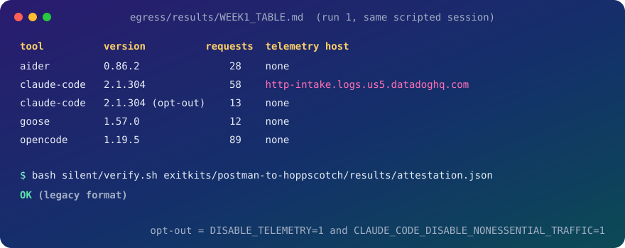

<p align="center">
  
</p>

<h1 align="center">Stillherd: a quiet, provable agent fleet</h1>

<p align="center">
  <b>Run fleets of coding agents that cannot wreck each other, and prove what they sent out.</b><br>
  Guardrails on the default path, allowlisted silent runs, and a signed attestation of every byte that left.
</p>

<p align="center">
  
</p>

<p align="center">
  <a href="#1-sixty-seconds">Quick start</a> · <a href="#2-what-you-get">What you get</a> · <a href="#3-evidence">Evidence</a> · <a href="#faq">FAQ</a>
</p>

<p align="center"><code>bash install.sh /path/to/your/project</code></p>

<p align="center">
  
</p>

<table align="center">
  <tr>
    <td align="center"><h3>4</h3><sub>AI coding tools, egress<br>logged in scripted runs</sub></td>
    <td align="center"><h3>0 bytes</h3><sub>external, while a Postman<br>collection moved to Hoppscotch</sub></td>
    <td align="center"><h3>5</h3><sub>laws, each written<br>by a real incident</sub></td>
    <td align="center"><h3>6 / 6</h3><sub>guard tests pass<br>on a distro without node</sub></td>
  </tr>
</table>

---

## Contents

1. [Sixty seconds](#1-sixty-seconds)
2. [What you get](#2-what-you-get)
3. [Evidence](#3-evidence)
4. [Five laws and the incidents that wrote them](#4-five-laws-and-the-incidents-that-wrote-them)
5. [How the pieces fit](#5-how-the-pieces-fit)
6. [Verifying an attestation](#6-verifying-an-attestation)
7. [What Stillherd never does](#7-what-stillherd-never-does)
8. [Layout](#8-layout)

---

## 1. Sixty seconds

```bash
git clone https://github.com/ripplarity/stillherd.git && cd stillherd
bash install.sh /path/to/your/project              # hooks + the stillherd CLI into .claude/
/path/to/your/project/.claude/bin/stillherd status # leases, ledger, orphans, claims on one screen
/path/to/your/project/.claude/bin/stillherd today  # the day: processes, hosts, bytes out, claims; writes ~/.stillherd/days/<date>.dsse.json (tests/test_today.sh) (the day predicateType is listed in attest-spec 1.4: verify.sh prints VALID-SIGNATURE, VALID and exits 0)
STILLHERD_REPO=$PWD bash stillherd audit opencode --from RUN1.jsonl RUN2.jsonl  # default vs opt-out egress per host (tests/test_audit.sh)
bash stillherd watch curl -s https://example.com   # blocks nothing: host table, watch.requests.jsonl, signed watch.attestation.dsse.json (tests/test_watch.sh)

# run any agent command with only localhost allowed, and get a signed attestation
OLLAMA_API_BASE=http://127.0.0.1:11434 bash silent/silent.sh \
  aider --model ollama_chat/qwen2.5-coder:7b --message "say hi" --yes-always --no-git
bash silent/verify.sh attestation.dsse.json        # OK, or which check failed (signature, keyid pin, log hash)
```

You need bash, python3 and git. `silent.sh` also needs `mitmdump` on PATH (`uv tool install mitmproxy`, or `pip install --user mitmproxy`); `egress/run_tool.sh` installs it the same way if it's missing. Docker is needed only for `selfhost/` and `exitkits/`.

## 2. What you get

| | You run | You get |
|---|---|---|
| **Guardrails** | `install.sh` into any project that uses Claude Code hooks | Kill-tree, CPU and GPU leases, a stash ban, and claim receipts, all enforced by hooks on the default path. The CLI is `stillherd status`. |
| **Silent runs** | `silent/silent.sh aider ...` (any agent, any model server) | Every host outside your local allowlist is refused and every attempt is logged. The run ends with an ed25519-signed attestation of the hosts contacted and the bytes sent. Of the command line, only the command name and argument count are recorded by default; request paths are kept without the query string, and path segments are still recorded. `SILENT_KEEP_ARGV=1` also records the command line as given, apart from bare path arguments (reduced to file names); it can contain secrets, and the file is marked. |
| **Watch runs** | `stillherd watch <cmd>` | The command runs normally. You get a table of external hosts (requests, bytes out, rule), a request log with no bodies, and a signed attestation marked mode observe. Only the command name and argument count are recorded, and query strings are dropped. |
| **Receipts for leaving SaaS** | `selfhost/selfhost.sh postman`, `exitkits/postman-to-hoppscotch/kit.sh` | An open replacement boots, your data is imported, and the whole window is attested. |
| **Egress tables** | `egress/run_tool.sh` | A reproducible record of what a named AI coding tool sends out during a fixed scripted session. |

## 3. Evidence

Every number here is produced by a file in this repository, and can be re-checked with the command shown.

| Result | Where | Check |
|---|---|---|
| Four AI coding tools, two scripted runs each: hosts, request counts, bytes, and a classification per host | [egress/results/WEEK1_TABLE.md](egress/results/WEEK1_TABLE.md) and the `egress/results/*.jsonl` request logs (metadata only; query strings and ids redacted by `egress/redact.py`) | `python egress/classify.py` rebuilds the table from the logs |
| Hoppscotch and Rocket.Chat booted under the attestation proxy: external hosts and bytes out, signed | [selfhost/results/SELFHOST_TABLE.md](selfhost/results/SELFHOST_TABLE.md) | `bash silent/verify.sh selfhost/results/hoppscotch.attestation.json` |
| A Postman collection imported into self-hosted Hoppscotch with zero external bytes, signed | [exitkits/postman-to-hoppscotch/README.md](exitkits/postman-to-hoppscotch/README.md) | `bash silent/verify.sh exitkits/postman-to-hoppscotch/results/attestation.json` |
| The guard hooks work without node, on a fresh distro | [tests/test_guards.sh](tests/test_guards.sh), [D5_CLEANRUN.md](D5_CLEANRUN.md) | `bash tests/test_guards.sh` |

> **What the tables do not say.** A tool that contacted no telemetry host in a ten-minute scripted session may do so in other sessions, and a proxy sees only traffic that honours proxy settings. Each component's README lists its limits.

## 4. Five laws and the incidents that wrote them

These figures come from the maintainer's own incident log on one shared workstation. They are not reproduced in this repository.

| Law | The incident behind it | The loss it prevents |
|---|---|---|
| **Kill-tree** | A killed parent orphaned a filesystem scan that burned 24,604 CPU-seconds over seven hours; 14 search processes leaked the same day. | Ownerless runaway processes left behind when only the parent is killed |
| **GPU lease** | Two GPU jobs sharing one card took a render from 45 s/step to 1,637 s/step. | Two jobs thrashing one GPU until both crawl |
| **Stash ban** | A shared stash stack let one agent pop another's entry, and the work was not recoverable. | One agent destroying another's uncommitted work |
| **CPU lease** | Eleven core-pinned jobs ran unbudgeted for hours, and a headless emulator ran 8 h at 14 cores without anyone seeing it. | Agents starving each other of cores |
| **Claim receipts** | A worker's "done" is a claim, not a fact. | Unverified "done" claims shipping as fact |

What each law means in practice: kill process trees leaves first, never a bare parent; run one heavy GPU job at a time, claimed by lease; `git stash` is denied by hook, so read other revisions with `git show` or a worktree; heavy work claims cores from a shared budget first; and a hook records every "done" while acceptance commands verify it.

## 5. How the pieces fit

- **Leases are property.** You hold cores or the GPU by claim. A stale claim expires; a live one is respected.
- **Receipts are courts.** A claim is only as good as the acceptance check that confirms it.
- **Messaging is mail.** Agents ask each other. They don't reach into each other's work.
- **Kill-tree is death.** When a process ends, everything it spawned ends with it, leaves first.
- **Silence is signed.** A run's network behaviour is a signed artefact, not a policy page.

## 6. Verifying an attestation

An attestation is a signed statement: a DSSE envelope over an in-toto Statement v1. `silent/verify.sh` checks the ed25519 signature and the subject log hash, and it trusts only a key whose keyid matches the pin. That pin is either the maintainer keyid published in [silent/README.md](silent/README.md) or one you pass as the second argument.

<details>
<summary><b>Format details</b></summary>

- Attestations written before the shared format (`corral-silent-1`, `stillherd-silent-1`) still verify, and are reported as "legacy format".
- Anchoring in a public transparency log (Rekor) is off, so an attestation proves who signed and what was logged, not when it was published.
- Signed files are stored byte-exact (`.gitattributes`), so a fresh clone verifies.

</details>

## 7. What Stillherd never does

- Kill a peer's process.
- Raise a cap to make something run.
- Push for you.
- Store request or response bodies from the tools it observes.

## 8. Layout

| Path | Contents |
|---|---|
| `install.sh`, `merge_settings.py`, `stillherd` | Installer, settings merge, status CLI |
| `vendor/hooks/` | The hooks and tools that get installed: `proc_tree.py`, `cpu_lease.py`, `gpu_lease.py`, `run_leased.py`, `activity_ledger.py`, `claim_capture.py`, `verify_claims.py`, `git_guard.sh`, `stash_guard.sh` |
| `silent/` | Allowlist proxy, signed attestation, `verify.sh` |
| `egress/` | Egress harness, classifier, redaction, week-1 results |
| `selfhost/` | Compose recipes and boot attestations |
| `exitkits/` | Data migration into a self-hosted replacement, attested |
| `tests/` | Guard tests (run on a distro without node) |

## FAQ

**Does it read my prompts or code?**
No. The egress logs keep host, path, method and byte counts only. Request and response bodies are never stored, and query strings and ids are redacted.

**Which agents does it work with?**
`silent/silent.sh` wraps any command: any agent, any model server. The guardrails install as coding-agent hooks into a project's `.claude/` settings.

**What does the Datadog row in the egress table mean?**
That host received log requests during the scripted session; the table records hosts and byte counts, not contents. With `DISABLE_TELEMETRY=1` and `CLAUDE_CODE_DISABLE_NONESSENTIAL_TRAFFIC=1` set, one run made no requests to it.

**What does it cost?**
Nothing. It is Apache-2.0, runs locally, and needs bash, python3 and git (plus `mitmdump` for silent runs, and Docker only for `selfhost/` and `exitkits/`).

**Where has it been tested?**
The guard tests and installer run on a fresh Ubuntu 24.04 distro; see [D5_CLEANRUN.md](D5_CLEANRUN.md).

---

<p align="center"><sub>Apache-2.0 for everything written here; the compose recipes under <code>selfhost/recipes/</code> keep their upstream licences (see <a href="NOTICE">NOTICE</a>). Copyright 2026 Ripplarity Inc.</sub></p>

## Containment test

`demo/containment.sh` runs a scripted agent (plain bash) under `silent/silent.sh`: one allowed local request, then one outbound request to a non-allowlisted host. The proxy refuses the second and logs it, the run ends with a DSSE attestation, `verify.sh` checks it against the pinned keyid, and a copy with one flipped byte is shown failing. Real run, committed as `examples/containment_transcript.txt` (attestation `examples/containment.dsse.json`, log `examples/containment.silent.log.jsonl`):

```
BLOCKED example.com  at 2026-11-08T23:40:09Z
...
OK
...
FAIL (tampered copy rejected)
```

Limits: proxy-honouring traffic only (a process that ignores proxy settings or opens raw sockets is not seen), and no kernel or firewall enforcement is claimed. Re-run with `bash tests/test_containment.sh` (needs `mitmdump`).

## Timeline and explain

`stillherd timeline RUN_ID` (a run_leased job key or ledger id; or `--since <UTC>` for the latest run since then) prints one chronological view built only from records Stillherd already writes: ledger start/end, pid rebinds, leases, silent/egress rows, claims and their verify results, attestations. Every row ends with its source (file and line, or key). `stillherd explain RUN_ID` answers four questions: why terminated, why blocked, who held the GPU or cores, which claims passed. It adds no collection; run-recorders such as AgentOps, Langfuse and agent-blackbox exist, and this is a module over the files above.

Unknown is reported as UNKNOWN, never as a pass; no prompts, code or bodies are collected.

The exact fields read are listed at the top of `bin/timeline.py`; each record is reduced to that whitelist when parsed. Output on the committed fixture records under `tests/fixtures/timeline/` (the same files `tests/test_timeline.sh` compares against; the run is synthetic, dated 2027 on purpose):

```
stillherd timeline fx/demo (UTC)
2027-01-15T08:00:00Z  start     run started: id=100-1 job_key=fx/demo project=fxproj resource=cpu pid=100  [activity_ledger.jsonl:1]
2027-01-15T08:00:02Z  lease     cpu lease claimed: cores=4 id=100-1  [cpu.leases.json:id=100-1]
2027-01-15T08:00:05Z  attest    attestation keyid=abababababababab subjects=silent.log.jsonl (signature not checked here; use verify.sh)  [fx.dsse.json]
2027-01-15T08:00:20Z  proc-tree pid rebound to 200  [activity_ledger.jsonl:3]
2027-01-15T08:00:30Z  egress    allowed 127.0.0.1 bytes=120  [silent.log.jsonl:1]
2027-01-15T08:00:40Z  egress    blocked example.com bytes=0  [silent.log.jsonl:2]
2027-01-15T08:00:50Z  egress    request:POST api.example.net bytes=900  [e1.jsonl:1]
2027-01-15T08:02:00Z  claim     recorded id=c1  [claims.jsonl:1]
2027-01-15T08:03:00Z  claim     recorded id=c2  [claims.jsonl:2]
2027-01-15T08:04:00Z  claim     verified id=c1 verdict=survived claimed_done=True  [claims_verified.jsonl:1]
2027-01-15T08:05:00Z  end       run ended: status=failed  [activity_ledger.jsonl:4]
2027-01-15T08:05:01Z  run-state state=failed incarnation=1 restarts=1 mem_peak_mb=512  [runs/fx__demo.json]
stillherd explain fx/demo
why terminated: ledger end status=failed [activity_ledger.jsonl:4]; run state=failed restarts=1 [runs/fx__demo.json]
why blocked: 1 request(s) refused by the allowlist proxy: example.com [silent.log.jsonl:2]
who held GPU/cores: cpu cores=4 [cpu.leases.json:id=100-1]
which claims passed: claim c1: PASS verdict=survived [claims_verified.jsonl:1] (matched by project and time window)
which claims passed: claim c2: UNKNOWN (no verify result) (matched by project and time window)
Unknown is reported as UNKNOWN, never as a pass; no prompts, code or bodies are collected.
```

Stillherd protects the execution of work; Deja Spawn protects the systems behind it.
